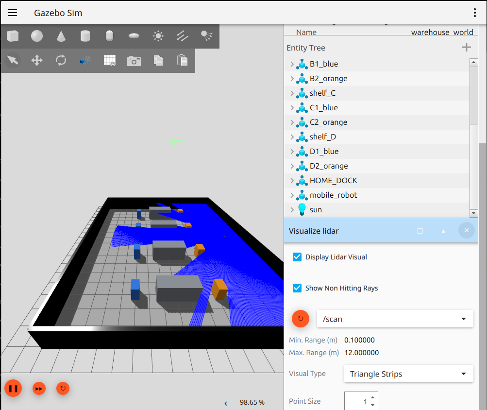
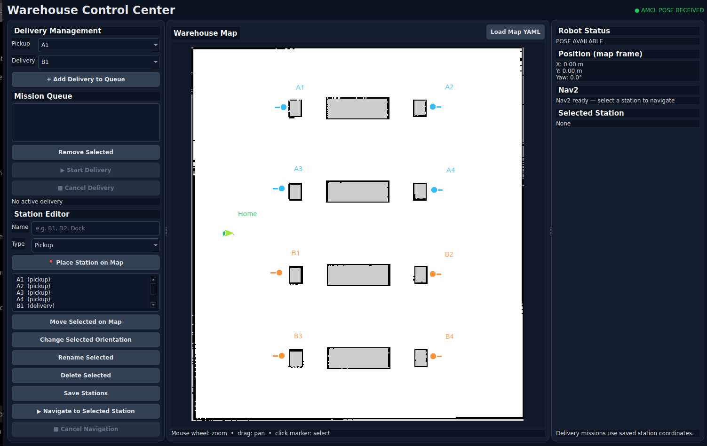

# ROS 2 Warehouse Control Center

A simulated autonomous warehouse robot built with **ROS 2 Jazzy**, **Gazebo Harmonic**, **Nav2**, and a **PySide6** desktop application. The system provides a warehouse simulation, mapping and localization, and a desktop interface for monitoring the robot and managing named stations.

## Features

- Differential-drive mobile robot with simulated 2D LiDAR.
- Warehouse environment with shelving and pickup/delivery locations.
- 2D mapping with SLAM Toolbox; localization on a saved map with AMCL.
- Autonomous point-to-point navigation with Nav2.
- PySide6 dashboard with a warehouse map and live robot position/orientation.
- Map-based station editing with named pickup, delivery, and dock locations.
- Delivery request queue in the desktop interface.

**Release:** `v1.0.0` — Desktop dashboard integration. Mission execution controls may depend on the ROS interface included in your checkout; test them in simulation before relying on them.

## Requirements

- Ubuntu 24.04
- ROS 2 Jazzy
- Gazebo Harmonic (Gazebo Sim 8)
- Nav2, SLAM Toolbox, `ros_gz_bridge`, `tf2_ros`, and RViz2
- Python 3.12, `python3-venv`, and the Python dependencies in `requirements.txt`

For autonomous frontier exploration, the separate `frontier_exploration_ros2` ROS 2 package must also be installed and available in your sourced workspace.

## Installation

Clone the repository:

```bash
git clone https://github.com/muhazawan04/ros2-warehouse-control.git
cd ros2-warehouse-control
```

Install ROS dependencies through your existing ROS 2 Jazzy installation, then set up the desktop environment:

```bash
python3 -m venv --system-site-packages .venv
source .venv/bin/activate
python -m pip install -r requirements.txt
```

Source ROS 2 Jazzy and your ROS 2 workspace as appropriate for your machine. The virtual environment uses `--system-site-packages` so the dashboard can access ROS Python packages such as `rclpy`.

## Running the system

### Saved-map navigation mode

Start the warehouse simulation and localization:

```bash
cd ~/ros2-warehouse-control
ros2 launch "$PWD/simulation/launch/delivery.launch.py"
```

<p align="center">
  
</p>

If the delivery launch does **not** already start Nav2 navigation servers, start them in a second terminal:

```bash
cd ~/ros2-warehouse-control
ros2 launch nav2_bringup navigation_launch.py \
  use_sim_time:=true \
  params_file:="$PWD/simulation/config/nav2_delivery_params.yaml" \
  autostart:=true
```

Start the desktop application in another terminal:

```bash
cd ~/ros2-warehouse-control
source .venv/bin/activate
python main.py
```
<p align="center">
  
</p>

The desktop application requires a valid saved map at `simulation/maps/warehouse_map.yaml` (with the associated image file) for the warehouse display.

## Creating and using a new warehouse map

The simulation has two separate operating modes: **mapping** (SLAM Toolbox creates an occupancy map) and **delivery** (Nav2 and AMCL navigate using a saved map). Do not run them at the same time.

### 1. Prepare the environment

To change the warehouse layout, edit `simulation/worlds/warehouse_world.sdf` and restart the simulation. The simulated world and occupancy map are separate: changing the Gazebo world does **not** update an existing map automatically.

### 2. Launch mapping mode

Stop any active delivery-mode simulation. From the repository root, run:

```bash
cd ~/ros2-warehouse-control
ros2 launch "$PWD/simulation/launch/warehouse.launch.py"
```

In a separate terminal, open RViz2:

```bash
ros2 run rviz2 rviz2 --ros-args -p use_sim_time:=true
```

Set **Fixed Frame** to `map`; add a **Map** display for `/map` and a **LaserScan** display for `/scan`. Explore the environment by driving the robot or, if `frontier_exploration_ros2` is installed, by running Nav2 with the mapping parameters and launching the frontier explorer:

```bash
# Terminal: Nav2 (while mapping mode is running)
cd ~/ros2-warehouse-control
ros2 launch nav2_bringup navigation_launch.py \
  use_sim_time:=true \
  params_file:="$PWD/simulation/config/nav2_params.yaml" \
  autostart:=true
```

```bash
# Terminal: frontier explorer (optional)
cd ~/ros2-warehouse-control
ros2 launch frontier_exploration_ros2 frontier_explorer.launch.py \
  params_file:="$PWD/simulation/config/warehouse_exploration.yaml" \
  use_sim_time:=true \
  autostart:=true
```

The explorer requires the external `frontier_exploration_ros2` package to be installed in a sourced ROS 2 workspace. Alternatively, use the navigation or velocity-command controls available in your setup to map the environment manually.

### 3. Save the occupancy map

After sufficient exploration, use a descriptive name so you can retain multiple maps:

```bash
cd ~/ros2-warehouse-control
ros2 run nav2_map_server map_saver_cli \
  -f "$PWD/simulation/maps/warehouse_v2" \
  --ros-args -p use_sim_time:=true
```

This saves **both** `warehouse_v2.yaml` (map metadata, resolution and origin) and `warehouse_v2.pgm` (occupancy image) in `simulation/maps/`. Keep these two files together; the `image:` field in the YAML must point to the matching image. Confirm that the map contains the expected boundaries and obstacles before using it for navigation.

### 4. Load the new map in the desktop dashboard

The dashboard can display any valid ROS occupancy-map YAML:

1. Start the application with `python main.py`.
2. Click **Load Map YAML** above the map.
3. Choose `simulation/maps/warehouse_v2.yaml`.
4. Verify the map image appears.
5. Use **Place Station on Map** to define pickup, delivery and dock locations in free space, set their stopping orientations, and click **Save Stations**.

**Station compatibility:** Station definitions are associated with a map fingerprint derived from the image, resolution and origin. When you load a different map, existing station markers may not appear. Recreate or verify stations against the new map before navigating. The dashboard currently stores the active station set in `config/stations.yaml`; if you need multiple station sets, manage them separately rather than assuming the dashboard automatically switches station files. Commit intentional changes using Git.

### 5. Use the new map for AMCL and Nav2

**Loading a map in the dashboard does not change the map used by AMCL.** In this release, `simulation/launch/delivery.launch.py` explicitly uses `simulation/maps/warehouse_map.yaml`. To make the new map the navigation map, edit the localization launch argument in that file:

```python
'map': os.path.expanduser(
    os.path.join(project_dir, 'maps', 'warehouse_v2.yaml')
),
```

Stop the mapping session before starting delivery mode:

```bash
cd ~/ros2-warehouse-control
ros2 launch "$PWD/simulation/launch/delivery.launch.py"
```

Then start the dashboard, load **the same** `warehouse_v2.yaml` through **Load Map YAML**, and verify that the robot marker aligns with the map and Nav2 can reach a safe test goal. If the new SLAM map has a different frame origin or initial robot pose, the AMCL `initial_pose` settings in `simulation/config/nav2_delivery_params.yaml` may also need adjustment; do not assume the original docking pose is valid on every newly generated map.

## Dashboard usage

1. Start the saved-map simulation with AMCL and Nav2.
2. Launch `python main.py`.
3. Use **Load Map YAML** to select the same map that delivery mode loaded into AMCL; check the robot's live marker and localization status.
4. Add or select pickup, delivery, and dock stations on the map. Position navigation goals in free space next to obstacles, not inside them.
5. Save station locations so they can be reused on the same map.
6. Create delivery requests in the queue. Verify navigation functions in simulation before using them with a physical robot.

**Map compatibility:** Station coordinates are tied to a particular occupancy map. If you replace the map, check or recreate station positions before navigation.

## Project layout

```text
ros2-warehouse-control/
├── main.py                    # PySide6 desktop application
├── core/                      # ROS 2 interface and application logic
├── ui/                        # UI components
├── config/                    # Saved station definitions
├── simulation/
│   ├── worlds/                # Gazebo worlds
│   ├── models/                # Robot model and meshes
│   ├── launch/                # Simulation launch files
│   ├── config/                # ROS–Gazebo bridge, SLAM and Nav2 settings
│   └── maps/                  # Occupancy-grid maps
├── requirements.txt
└── README.md
```

## Troubleshooting

- **Dashboard won't appear:** Run `python -u main.py` in a terminal and inspect any errors. A station/map mismatch should not block the main window from opening.
- **No robot position:** Check that AMCL is running and `/amcl_pose` is available (`ros2 topic info /amcl_pose -v`).
- **No LiDAR scan:** Check `/scan` and the Gazebo bridge configuration.
- **Nav2 goals fail:** Confirm the map, localization, TF frames, obstacle clearance, and configured goal tolerances.

## Versions

Git tags capture the project at each milestone. To use this release:

```bash
git fetch --tags
git switch --detach v1.0.0
```

To return to the latest development branch:

```bash
git switch main
```

Previous tags document the progression from the Gazebo world and robot model through LiDAR, ROS 2 integration, SLAM, warehouse navigation, and localization.

## Third-party assets

The robot uses TurtleBot3-derived mesh assets. Retain the relevant upstream copyright, license, and attribution notices when redistributing these files.
